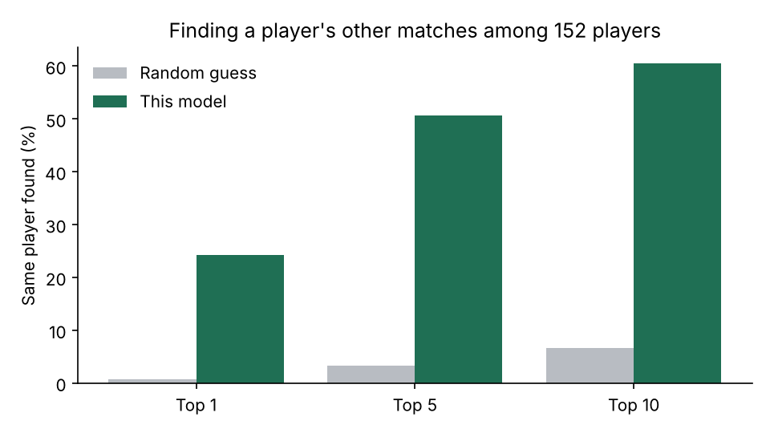

# Similar Players

Clubs often need to replace a player, not just sign a good one. This project looks at how a player actually plays, using match event data, and finds other players with a similar style.

Give it a name and it returns the closest players in the same position:

```
$ python -m similar_players.find "Rodrigo Hernández" --top 3

Rodrigo Hernández Cascante (Spain, Midfielder, 958 minutes)

               player    team  similarity  minutes
           Toni Kroos Germany       0.814   489.30
Pierre-Emile Højbjerg Denmark       0.750   658.25
       Nicolò Barella   Italy       0.739   350.19
```

## Data

I used StatsBomb open data for 153 matches: FIFA World Cup 2022, Euro 2024, Copa America 2024, and the 6 MLS 2023 matches in the release. That gives 4,771 player matches and 417 outfield players with at least 270 minutes.

Each player gets a profile of 21 style features. Most are per 90 minutes, such as progressive passes, progressive carries, dribbles, xG, box touches, pressures, tackles and recoveries. The rest describe how and where they play, such as pass completion, average height on the pitch and how wide they play. Set pieces and penalties are left out of the passing and shooting numbers.

## How I tested it

"Similar" is hard to prove, because there is no answer key for who plays like whom. So I used a test with a known answer. I split each player's matches into two halves that share no match, then asked whether one half could find the same player's other half.

Scores below use 152 players the method was not tuned on. Another 152 players were used to choose the method.

| | Top 1 | Top 5 | Top 10 | Median rank |
| --- | --- | --- | --- | --- |
| Random guess | 0.7% | 3.3% | 6.6% | 76.5 |
| PCA with 9 components | 17.1% | 37.5% | 50.7% | 10 |
| **Scaled features (used)** | **24.3%** | **50.7%** | **60.5%** | **5** |
| Scaled features, teammates removed | 24.3% | 51.3% | 60.5% | 5 |



What I took from this:

- A player's style holds up from one set of matches to another. The correct player is in the top 5 about half the time, from a very small sample.
- PCA made things worse here, so I dropped it, even though it is the usual first step.
- Removing teammates barely changed the result, so the model is not just recognizing a team's style.

## Run it

```bash
pip install -r requirements.txt
pytest
python -m similar_players.find "Virgil van Dijk"
python -m similar_players.evaluate
```

`data/` already holds the processed tables. To rebuild them, clone [statsbomb/open-data](https://github.com/statsbomb/open-data) and run:

```bash
python -m similar_players.build --open-data path/to/open-data
```

## Limits

- Most of the data is short international tournaments, so many players have only a handful of matches. Scores from a few hundred minutes are noisy.
- International players are not a good match for an MLS recruitment list. I would rerun this on a full league season before using it for scouting.
- Style is not quality. A similar player can still be much better or worse.
- Event data shows what happened on the ball. It misses off-ball movement, which tracking data would capture.
- The split-half test measures whether style is stable. It does not prove that the top matches would look right to a scout.

## Next steps

- Add possession value, so the model can rank similar players by impact.
- Use the 360 freeze frames to add how much pressure a player is under.
- Adjust for how often a team has the ball, since that changes many per 90 numbers.

## Data source

Data provided by StatsBomb.


